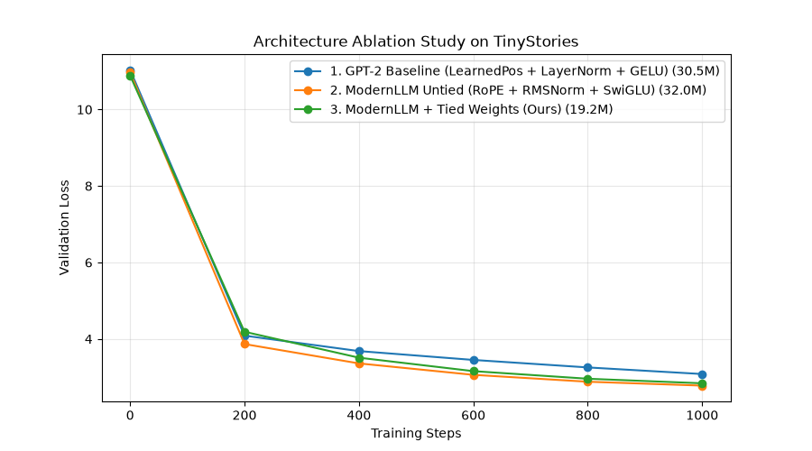

# ModernLLM — A Modern Language Model Built from Scratch

A compact causal language model implemented in **PyTorch**, featuring modern Transformer components, controlled architectural ablations, autoregressive KV-cache inference, and supervised fine-tuning.

ModernLLM explores how modern LLM architecture choices affect model quality, parameter efficiency, training behavior, and inference performance on consumer hardware.

The project replaces traditional GPT-2-style components with:

- Rotary Position Embeddings (RoPE)
- Root Mean Square Normalization (RMSNorm)
- SwiGLU feed-forward networks
- Tied token embeddings and output projection weights
- Grouped Query Attention (GQA)
- Autoregressive KV caching

The model was pretrained on **TinyStories** and developed on Apple Silicon using PyTorch MPS.

---

## Key Results

| Experiment | Result |
|---|---:|
| ModernLLM parameters (tied) | 19.16M |
| GPT-2 baseline parameters | 30.53M |
| Pretraining steps | 6,000 |
| Tokens processed during pretraining | ~49.15M |
| Best pretraining validation loss | 1.8875 |
| Pretraining perplexity | 6.60 |
| Best SFT response validation loss | 1.7402 |
| KV-cache inference speed | 292.49 tokens/sec |
| Measured KV-cache speedup | 2.04× |

**Highlights**

- Approximately 37.2% fewer parameters than the GPT-2 baseline.
- Approximately 21.5% lower perplexity than the GPT-2 baseline in the reported ablation experiment.
- Approximately 40.2% fewer parameters compared with the untied ModernLLM configuration.
- A custom autoregressive KV-cache implementation achieving a measured 2.04× speedup in the reported benchmark.

*All performance measurements are experimental results from the configurations described below. Inference speed depends on hardware, sequence length, and generation settings.*

---

## Architecture

| Component | GPT-2 baseline | ModernLLM |
|---|---|---|
| Positional encoding | Learned absolute embeddings | RoPE |
| Normalization | LayerNorm | RMSNorm |
| Feed-forward network | GELU | SwiGLU |
| Attention | Standard scaled dot-product | GQA with scaled dot-product attention |
| Weight sharing | Untied | Tied |
| Inference | Standard autoregressive | KV-cache enabled |

### Architecture details

**1. Rotary Position Embeddings (RoPE)**

RoPE encodes positional information through rotations applied to query and key representations.

**2. RMSNorm**

Uses root mean square normalization instead of mean-and-variance normalization.

**3. SwiGLU**

Uses a gated feed-forward architecture with the SiLU activation function.

**4. Grouped Query Attention**

Shares key-value heads across multiple query heads to reduce the size of key-value representations.

**5. Weight tying**

Shares the token embedding matrix with the language-model output projection, reducing the number of trainable parameters.

**6. KV Cache**

Stores previously computed key and value tensors during autoregressive generation, avoiding redundant computation for earlier tokens.

---

## Controlled Architecture Ablation

Three configurations were evaluated using the same reported training setup:

- Batch size: 16
- Sequence length: 256
- Optimizer: AdamW
- Learning rate: 5 × 10⁻⁴
- Training steps: 1,000

### Results

| Architecture | Parameters | Validation Loss | Perplexity | Training Time |
|---|---:|---:|---:|---:|
| GPT-2 baseline (LearnedPos + LayerNorm + GELU) | 30.53M | 3.0835 | 21.83 | 462.5s |
| ModernLLM untied (RoPE + RMSNorm + SwiGLU) | 32.03M | 2.7809 | 16.13 | 583.1s |
| ModernLLM tied | 19.16M | 2.8413 | 17.14 | 596.8s |

### Observations

1. Replacing the legacy architecture components with RoPE, RMSNorm, and SwiGLU reduced perplexity from 21.83 to 16.13 in this experiment.
2. Weight tying reduced the parameter count from 32.03M to 19.16M.
3. The tied configuration retained much of the improvement over the baseline while using substantially fewer parameters.
4. The tied configuration had slightly higher validation loss than the untied configuration.

These results demonstrate the observed trade-offs in these particular experiments; they do not isolate the contribution of every individual architectural component.



---

## Pretraining

ModernLLM was pretrained on the [TinyStories dataset](https://huggingface.co/datasets/roneneldan/TinyStories).

### Training configuration

| Setting | Value |
|---|---|
| Architecture | Tied ModernLLM |
| Parameters | 19.16M |
| Context length | 512 |
| Batch size | 16 |
| Training steps | 6,000 |
| Optimizer | AdamW |
| Learning rate | 5 × 10⁻⁴ |
| Weight decay | 0.1 |
| Warmup | 300 steps |
| Scheduler | Cosine decay |
| Final learning rate | 5 × 10⁻⁵ |
| Gradient clipping | 1.0 |

### Training trajectory

| Step | Train Loss | Validation Loss | Perplexity |
|---:|---:|---:|---:|
| 0 | 10.8611 | 10.8615 | 52,131.10 |
| 1,000 | 2.6749 | 2.6831 | 14.63 |
| 3,000 | 2.1293 | 2.1055 | 8.21 |
| 4,500 | 1.9621 | 1.9331 | 6.91 |
| 5,999 | 1.8825 | 1.8875 | 6.60 |

The final reported pretraining checkpoint is:

`checkpoints/best.pt`

The model processed approximately 49.15 million training tokens over 6,000 steps.

---

## Evaluation

The evaluation pipeline measures language-model loss, generation diversity, repetition, entity retention, completion behavior, and inference throughput.

### Reported evaluation metrics

| Metric | Result |
|---|---:|
| Validation loss | 1.9291 |
| Validation perplexity | 6.88 |
| Distinct-1 | 0.3166 |
| Distinct-2 | 0.7770 |
| Distinct-3 | 0.9392 |
| 4-gram repetition rate | 0.0065 |
| Entity retention rate | 75% |
| Clean completion rate | 100% |
| KV cache disabled | 143.69 tok/s |
| KV cache enabled | 292.49 tok/s |
| Speedup | 2.04× |

### Metric interpretation

- **Distinct-n:** Measures lexical diversity across generated text.
- **4-gram repetition rate:** Measures repeated four-token sequences.
- **Entity retention:** Measures whether introduced characters remain present in the later part of generated narratives.
- **Clean completion:** Measures whether outputs satisfy the implemented completion heuristic.
- **Inference throughput:** Measures generated tokens per second.

The clean completion rate is a heuristic-based metric, not a human assessment of narrative quality or coherence.

The evaluation report is saved to `eval_report.json`.

---

## Supervised Fine-Tuning (SFT)

After pretraining, the model was fine-tuned on TinyStories using a synthetic instruction template.

### Instruction format

```text
Instruction: Write a wholesome children's story with a clear beginning, middle, and ending.
Story:
```

### Training configuration

| Setting | Value |
|---|---|
| Starting checkpoint | `checkpoints/best.pt` |
| Training steps | 600 |
| Batch size | 16 |
| Learning rate | 2 × 10⁻⁵ |
| Optimizer | AdamW |
| Weight decay | 0.01 |
| Evaluation interval | 50 steps |
| Best checkpoint step | 400 |

### Response-only loss masking

Prompt tokens are excluded from the training objective using the ignore index `-100`.

This ensures that the loss is calculated on the response portion rather than the instruction prefix.

### SFT results

| Metric | Result |
|---|---:|
| Initial SFT validation loss | 1.7997 |
| Best SFT validation loss | 1.7402 |
| Best checkpoint | Step 800 |

The best checkpoint is saved as:

`checkpoints/sft_best.pt`

**Important scope limitation:** This experiment uses a single synthetic instruction template and children's stories. It demonstrates instruction-conditioned story generation, not general-purpose instruction following.

The SFT response validation loss is measured on a different objective and data format from ordinary pretraining validation loss, so the two values should not be compared directly.

### Controlled Base vs SFT benchmark

A controlled comparison was conducted using 50 fixed prompts across multiple story categories.

Both models received identical formatted prompts and decoding settings:

| Setting | Value |
|---|---:|
| Prompts | 50 |
| Maximum new tokens | 180 |
| Temperature | 0.60 |
| Top-k | 30 |
| Top-p | 0.85 |
| Repetition penalty | 1.18 |
| Classifier-free guidance | Disabled |

#### Automated rubric results

| Dimension | Maximum | Base | SFT |
|---|---:|---:|---:|
| Character adherence | 20 | 6.80 | 15.04 |
| Topic adherence | 20 | 8.51 | 10.68 |
| Narrative coherence | 25 | 20.90 | 25.00 |
| Character consistency | 15 | 5.88 | 6.96 |
| Ending quality | 10 | 8.24 | 8.72 |
| Repetition | 10 | 9.04 | 8.88 |
| **Total** | **100** | **59.37** | **75.28** |

The SFT model achieved a 15.91-point higher average automated rubric score.

**Evaluation caveat:** These scores come from heuristic automated proxies, including keyword coverage, length, sentence count, and repetition. They are not human-judged semantic quality scores or evidence of statistical significance. A separate blinded A/B scoring sheet was generated for further evaluation.

The experiment uses the same prompts and decoding hyperparameters, but identical random seeds do not guarantee identical sampling trajectories across different models.

Results are specific to this 50-prompt children's story benchmark and should not be interpreted as general-purpose instruction-following performance.

---

## Repository Structure

```text
Modern_llm_from_scratch/
│
├── config.py              # Hyperparameters and device setup
├── data.py                # TinyStories loading and tokenization
├── layers.py              # RMSNorm and RoPE
├── model.py               # ModernLLM architecture and KV cache
│
├── train.py               # Pretraining pipeline
├── ablation.py             # Architecture ablation experiments
├── evaluate.py             # Model evaluation
├── sft.py                  # Supervised fine-tuning
├── generate.py             # Text generation
├── compare.py              # Base vs SFT comparison
│
├── ablation_results.png    # Ablation visualization
├── eval_report.json        # Evaluation metrics
│
└── checkpoints/            # Generated model checkpoints
```

---

## Quickstart

### 1. Clone the repository

```bash
git clone https://github.com/Kakarot2812/Modern_llm_from_scratch.git

cd Modern_llm_from_scratch
```

### 2. Create a virtual environment

```bash
python3 -m venv .venv

source .venv/bin/activate
```

### 3. Install dependencies

```bash
pip install torch datasets tiktoken matplotlib
```

### 4. Run architecture ablations

```bash
python ablation.py
```

Generates the ablation results and performance comparison.

### 5. Pretrain ModernLLM

```bash
python train.py
```

Trains the model and saves the best checkpoint to `checkpoints/best.pt`.

### 6. Evaluate the pretrained model

```bash
python evaluate.py
```

Generates evaluation metrics and saves them to `eval_report.json`.

### 7. Run supervised fine-tuning

```bash
python sft.py
```

Loads the pretrained checkpoint and saves the best SFT checkpoint to `checkpoints/sft_best.pt`.

### 8. Generate text

```bash
python generate.py
```

### 9. Compare pretrained and SFT models

```bash
python compare.py
```

**Note:** Training and generation require the corresponding checkpoints. The training scripts create these locally. The model is designed to run on Apple Silicon MPS, CUDA, or CPU, subject to available memory and computational capacity.

---

## Hardware and Implementation

Developed and tested on:

- Apple Silicon MacBook Air M4
- 16 GB unified memory
- macOS
- Python 3.12
- PyTorch with MPS acceleration

The code includes device selection for MPS, CUDA, and CPU.

Training time and inference throughput will vary across hardware.

---

## Limitations and Future Work

Current limitations:

- Training data is focused on short children's stories.
- SFT uses a single synthetic instruction template.
- Generation quality still has narrative coherence and repetition issues.
- Qualitative comparison currently uses only four prompts.
- Reported ablation experiments do not isolate every architectural component independently.

Potential next improvements:

- Evaluate generation on a larger fixed benchmark.
- Compare multiple random seeds for architectural ablations.
- Add a genuinely aligned instruction-response dataset.
- Measure peak memory consumption and training throughput.
- Evaluate generation quality using human or independently validated model-based assessment.

---

## References

- **TinyStories:** Eldan & Li, [TinyStories: How Small Can Language Models Be and Still Speak Coherent English?](https://arxiv.org/abs/2305.07759)
- **RoPE:** Su et al., [RoFormer: Enhanced Transformer with Rotary Position Embedding](https://arxiv.org/abs/2104.09864)
- **RMSNorm:** Zhang & Sennrich, [Root Mean Square Layer Normalization](https://arxiv.org/abs/1910.07467)
- **SwiGLU:** Shazeer, [GLU Variants Improve Transformer](https://arxiv.org/abs/2002.05202)
- **Weight Tying:** Press & Wolf, [Using the Output Embedding to Improve Language Models](https://arxiv.org/abs/1608.05859)

---

## Author

**Nitesh Yadav**

GitHub: [@Kakarot2812](https://github.com/Kakarot2812)

Repository: [ModernLLM — From Scratch](https://github.com/Kakarot2812/Modern_llm_from_scratch)
